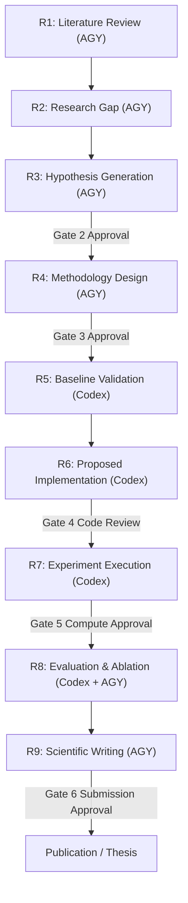

# Comprehensive Research Workflow Specification (R1–R9)

This document formalizes the 9-stage scientific lifecycle for the **Continual Relation Extraction with Task-Aware Prompt Adaptation (TAPA-CRE)** project. It delineates roles, inputs, required skills, outputs, acceptance criteria, and human approval gates across **Google Antigravity (AGY)** and **OpenAI Codex**.

---

## 1. Principles of Collaboration

1. **Role Specialization**:
   - **Google Antigravity (AGY)**: Specializes in scientific ideation, literature synthesis, hypothesis generation, architectural decomposition, rigor review, and academic writing.
   - **OpenAI Codex**: Specializes in production-grade PyTorch implementation, test suites, device configuration, experiment execution, numerical verification, and metric reporting.
2. **File-Based Communication**: All context transitions are mediated through `workflow/HANDOFF.md`, `workflow/STATUS.md`, and `workflow/TASKS.md`. Agents do not rely on shared ephemeral memory or chat history.
3. **Branch & Worktree Isolation**:
   - Long-running exploratory research by AGY occurs on `research/[topic-slug]`.
   - Feature implementations and refactoring by Codex occur on `feature/[task-slug]`.
   - Main branch (`main`) remains the pristine source of truth for validated, reproducible checkpoints and documents.

---

## 2. Nine-Stage Research Lifecycle Matrix

---

## 3. Detailed Stage Specifications

### Stage R1: Literature Review
- **Responsible Agent**: AGY
- **Inputs**: Research topic brief, seminal papers (FewRel, TACRED, ConPL, CPL, Prompt-Tuning).
- **Required Skills**: `@[0-autoresearch-skill]`, `@[research]`.
- **Steps**:
  1. Survey continual learning paradigms in NLP (replay-based, regularization, architecture expansion, prompt tuning).
  2. Extract performance baselines, memory budgets, and reported forgetting scores.
  3. Validate all paper citations against authentic DOIs or arXiv identifiers.
- **Expected Outputs**: `research/literature/cre-prompt-survey.md` with comparative taxonomy table.
- **Acceptance Criteria**: Minimum 10 authentic papers categorized across replay requirements, backbone freezing, and prompt adaptation strategies.
- **Human Approval Gate**: **Gate 1 (Scope Confirmation)**: User reviews and confirms literature coverage.

---

### Stage R2: Research Gap Identification
- **Responsible Agent**: AGY
- **Inputs**: Literature survey from Stage R1.
- **Required Skills**: `@[brainstorming-research-ideas]`, `@[rigor-reviewer]`.
- **Steps**:
  1. Contrast limitations of flat prompt pools against structured task hierarchies.
  2. Identify the trade-off between parameter explosion and semantic interference in prompt adaptation.
  3. Formulate the precise research questions addressing task identity blindness.
- **Expected Outputs**: `research/hypotheses/research-gaps.md`.
- **Acceptance Criteria**: Clear articulation of at least two explicit gaps where current literature fails or exhibits excessive forgetting.
- **Human Approval Gate**: None (Automated rigor review criteria).

---

### Stage R3: Hypothesis Generation
- **Responsible Agent**: AGY
- **Inputs**: Research gaps from Stage R2.
- **Required Skills**: `@[brainstorming-research-ideas]`, `@[creative-thinking-for-research]`.
- **Steps**:
  1. Formulate testable scientific hypotheses:
     - *H1 (Hierarchy)*: Structuring prompts into a domain-predicate tree achieves higher forward transfer than flat prompt pools.
     - *H2 (Routing)*: Prototype cosine similarity routing reliably predicts task/relation clusters without explicit task IDs.
     - *H3 (Distillation)*: EMA teacher distillation on prototype representations reduces backward forgetting ($F_T$) by > 15% relative to unconstrained prompt tuning.
- **Expected Outputs**: `research/hypotheses/formal-hypotheses.md`.
- **Acceptance Criteria**: Every hypothesis must be quantitatively falsifiable using $A_T$ and $F_T$ metrics.
- **Human Approval Gate**: **Gate 2 (Hypothesis Approval)**: User signs off on hypotheses before architectural engineering begins.

---

### Stage R4: Methodology Design
- **Responsible Agent**: AGY (with Codex review)
- **Inputs**: Approved hypotheses from Stage R3.
- **Required Skills**: `@[peft]`, `@[knowledge-distillation]`, `@[architecture]`.
- **Steps**:
  1. Define mathematical formulation for the prompt tree token concatenation.
  2. Specify dynamic soft routing equation with temperature scaling.
  3. Formulate the composite loss function: $\mathcal{L}_{total} = \mathcal{L}_{CE} + \lambda_{KD} \mathcal{L}_{KD} + \lambda_{proto} \mathcal{L}_{proto}$.
- **Expected Outputs**: `research/methodology/tapa-formulation.md`.
- **Acceptance Criteria**: Exact index notation, tensor dimensions, and backward gradient flow paths documented.
- **Human Approval Gate**: **Gate 3 (Methodology Approval)**: Architectural review by human researcher.

---

### Stage R5: Baseline Implementation & Purity Verification
- **Responsible Agent**: Codex
- **Inputs**: `configs/b0_sequential_ft_fewrel_5shot_seed2021.yaml`, `experiments/run_sequential_ft.py`.
- **Required Skills**: `@[clean-code]`, `@[accelerate]`, `@[verify-changes]`.
- **Steps**:
  1. Verify Baseline B0 purity boundaries: strictly zero memory buffer, no prototype cache.
  2. Run unit tests on task batch generators and metric calculation modules.
  3. Ensure results match registered benchmark run `E001`.
- **Expected Outputs**: Test reports in `reports/`, baseline verification confirmation.
- **Acceptance Criteria**: `pytest experiments/tests` passes 100%; metric calculations align with standard CRE benchmark protocols.
- **Human Approval Gate**: None.

---

### Stage R6: Proposed Method Implementation
- **Responsible Agent**: Codex
- **Inputs**: `research/methodology/tapa-formulation.md`, `configs/`.
- **Required Skills**: `@[peft]`, `@[bitsandbytes]`, `@[ml-training-recipes]`, `@[clean-code]`.
- **Steps**:
  1. Implement `HierarchicalPromptTree` module in PyTorch.
  2. Implement `PrototypeRouter` with cosine similarity soft selection.
  3. Implement `EMATeacherDistillation` wrapper.
  4. Write comprehensive unit tests for forward and backward passes.
- **Expected Outputs**: Implementation in `experiments/models/tapa/` and corresponding unit tests in `experiments/tests/`.
- **Acceptance Criteria**: All prompt modules load without modifying frozen backbone weights; unit tests verify gradient updates occur only on adapter/prompt parameters.
- **Human Approval Gate**: **Gate 4 (Code Review)**: Human inspects model architecture and verifies parameter isolation.

---

### Stage R7: Experiment Execution
- **Responsible Agent**: Codex
- **Inputs**: Verified model code, dataset configurations for FewRel Track A & TACRED.
- **Required Skills**: `@[accelerate]`, `@[tensorboard]`, `@[weights-and-biases]`, `@[ml-training-recipes]`.
- **Steps**:
  1. Verify device availability (Apple Silicon MPS / CUDA).
  2. Execute sequential task training (Tasks 1 through 8).
  3. Checkpoint model weights and log intermediate loss curves to local TensorBoard / CSV.
- **Expected Outputs**: Evaluation performance matrix $R_{i,j}$ and checkpoints in `runs/`.
- **Acceptance Criteria**: Experiment terminates cleanly; full accuracy matrix recorded without NaN or numerical instability.
- **Human Approval Gate**: **Gate 5 (Compute & GPU Authorization)**: Explicit user approval required before launching multi-task training runs.

---

### Stage R8: Evaluation and Ablation Analysis
- **Responsible Agent**: Codex (Computation) + AGY (Scientific Synthesis)
- **Inputs**: Raw experiment outputs from Stage R7.
- **Required Skills**: `@[lm-evaluation-harness]`, `@[academic-plotting]`, `@[rigor-reviewer]`.
- **Steps**:
  1. Compute final Average Accuracy: $A_T = \frac{1}{T} \sum_{i=1}^T R_{T, i}$.
  2. Compute Average Forgetting: $F_T = \frac{1}{T-1} \sum_{i=1}^{T-1} \max_{t \in \{1,\dots,T-1\}} (R_{t,i} - R_{T,i})$.
  3. Execute ablation runs (w/o Prompt Tree, w/o Prototype Routing, w/o EMA KD).
  4. Generate publication-quality SVG plots.
- **Expected Outputs**: `research/results/evaluation-summary.md` and SVG plots in `research/results/plots/`.
- **Acceptance Criteria**: Statistical significance tests reported across seeds (mean $\pm$ std).
- **Human Approval Gate**: None.

---

### Stage R9: Scientific Writing
- **Responsible Agent**: AGY
- **Inputs**: Literature survey, methodology, hypotheses, evaluation tables, and ablation plots.
- **Required Skills**: `@[ml-paper-writing]`, `@[academic-plotting]`, `@[rigor-reviewer]`.
- **Steps**:
  1. Draft paper sections in standard ACL/NeurIPS format: Introduction, Related Work, Method, Experiments, Analysis, Conclusion.
  2. Ensure strict alignment between claimed empirical gains and actual numbers in `workflow/EXPERIMENT_REGISTRY.md`.
  3. Check against ARA Rigor Reviewer guidelines.
- **Expected Outputs**: `research/papers/tapa-cre-paper.md` (and LaTeX source in `research/papers/latex/`).
- **Acceptance Criteria**: No unsubstantiated claims; all cited references verified against official databases; formatting adheres strictly to conference guidelines.
- **Human Approval Gate**: **Gate 6 (Pre-Submission Approval)**: Final human approval before paper submission or dissemination.
