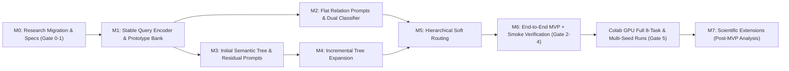

# Lộ Trình Triển Khai & Quality Gates: DynaTree-CRE (M0–M7)

## 1. Đồ Thị Phụ Thuộc (Dependency Graph)

---

## 2. Chi Tiết Milestones, Tiêu Chí Nghiệm Thu & Gates

### M0 — Research Direction Migration (`Gate 0` & `Gate 1`)
- **Objective:** Audit toàn bộ repo hiện tại, bảo toàn lịch sử TAPTA, thiết lập Source of Truth và đặc tả toán học/kiến trúc cho DynaTree-CRE.
- **Inputs:** Repo `research-code-lab`, Vault `Knowledge Hub`, các quyết định A1–A4.
- **Outputs:** `RESEARCH_DIRECTION_MIGRATION.md`, `RESEARCH_DIRECTION.md`, `RELATED_WORK.md`, `RD-001`..`RD-012`, `METHOD_SPEC.md`, `MATHEMATICAL_FORMULATION.md`, `EXPERIMENT_PROTOCOL.md`, logs, nhánh `feat/dynatree-cre`.
- **Acceptance Criteria / DoD:** Không xóa/ghi đè artifact cũ; mọi tài liệu cũ hết hiệu lực được đánh dấu `superseded`; có ma trận đối chiếu tài liệu và danh sách kiểm soát rò rỉ dữ liệu.

### M1 — Frozen Prototype Control (`DT-C0`)
- **Objective:** Triển khai `StableQueryEncoder` (freeze 100%, `eval()` mode) + `SemanticPrototypeBank` (T1-centered & raw cosine) + đánh giá nearest-prototype.
- **Dependencies:** M0.
- **Acceptance Criteria / DoD:** Không đổi bất kỳ tham số encoder nào; `M=0` replay; kiểm thử unit & chạy thực tế 8 task `DT-C0` trên FewRel Track A.

### M2 — Flat Relation Prompt Routing (`DT-C1`, `DT-C2`)
- **Objective:** Triển khai `HierarchicalPromptBank` (chế độ flat leaf), `TaskAgnosticRouter` (`flat_hard`, `flat_soft_topk`, `dense_soft`) và `ExpandableCosineClassifier` + `PromptedNCMClassifier`.
- **Dependencies:** M1.
- **Acceptance Criteria / DoD:** Gradient chảy đúng vào prompt mới và classifier mới; old prompts & old classifier weights giữ nguyên bit-exact sau `optimizer.step()`.

### M3 — Initial Semantic Hierarchy
- **Objective:** Triển khai `TreeNode`, `DynamicSemanticTree`, clustering trung bình trên cosine distance tại $T_1$, residual prompt inheritance $P_{\text{root}} + P_v + \Delta P_r$, serialization JSON và ASCII visualization.
- **Dependencies:** M1.
- **Acceptance Criteria / DoD:** Tuân thủ toàn bộ 11 bất biến cây; không dùng `ward` trên cosine; round-trip JSON khớp 100%.

### M4 — Dynamic Tree Expansion
- **Objective:** Triển khai chèn gia tăng `insert_task_relations`, tạo cụm mới khi dưới ngưỡng, cập nhật cluster prototype, giữ ổn định `node_id` và đồng bộ tham số prompt mới.
- **Dependencies:** M3.
- **Acceptance Criteria / DoD:** Thứ tự chèn deterministic theo `relation_id`; từ chối duplicate relation; không thay đổi parent của leaf cũ; ghi log thay đổi topology mỗi task.

### M5 — Hierarchical Soft Routing (`DT-C3`, `DT-C4`)
- **Objective:** Triển khai log-space hierarchical probabilities $\pi(j\mid x)\pi(r\mid j,x)$, global Top-K renormalization, $\beta_v$ cluster aggregation, routing diagnostics (Recall@K, Cluster Acc, Entropy, Oracle Gap).
- **Dependencies:** M2, M4.
- **Acceptance Criteria / DoD:** Tổng $\pi(r\mid x) = 1.0$; ổn định ở nhiệt độ thấp ($\tau = 0.01$); $P_{\text{root}}$ cộng đúng 1 lần; hỗ trợ cả `DT-C3` (flat route trên cluster prompt) và `DT-C4` (hierarchical soft route).

### M6 — End-to-End MVP & Quality Gates (`Gate 2`–`Gate 4`)
- **Objective:** Tích hợp `DynaTreeCREModel` + `DynaTreeContinualTrainer` + `CheckpointManager` (resume sạch), chạy full test suite (`tests/dynatree_cre/`), chạy smoke test synthetic + real FewRel `T1–T2` + kiểm tra resume.
- **Dependencies:** M1–M5.
- **Acceptance Criteria / DoD:** 100% unit/invariant/integration tests pass; checkpoint/resume không nhân bản node; `DT-C0` (8 tasks) & `DT-C4` (`T1–T2`) chạy thành công trên dữ liệu thật và lưu đủ artifacts theo `PART 23.3`.

### M7 — Scientific Extensions (Post-MVP Only)
- **Scope bị khóa khỏi MVP:** Multi-prototype routing, relation description enhancement, trainable router, adaptive threshold, split/merge/pruning, routing distillation, structure-preserving loss, LoRA, EMA Teacher. Chỉ mở khóa sau khi có kết quả phân tích đầy đủ `DT-C0..DT-C4` trên Colab GPU.

---

## 3. Quality Gates Checklist

- **Gate 0 (Repository Safety):** [x] Branch `feat/dynatree-cre` sạch; [x] Audit hoàn tất; [x] Không sửa/xóa artifact cũ.
- **Gate 1 (Research Specification):** [x] Hoàn thành đồng bộ doc set & `RD-001`..`RD-012`.
- **Gate 2 (Test Design):** [x] 7 nhóm test (`PART 21.1`–`21.7`) được đặc tả và triển khai.
- **Gate 3 (Implementation):** [x] Code `src/dynatree_cre/` pass review & 93/93 unit/integration tests.
- **Gate 4 (Experimental Verification):** [x] Synthetic e2e + Real FewRel smoke (`DT-C0`..`DT-C4` local code sanity) + Zero leakage/replay + Checkpoint/resume verified.
- **Gate 5 (Colab-Only Official Experiments):** `PENDING HUMAN COMPUTE APPROVAL` — **Toàn bộ 100% thực nghiệm dữ liệu thật chính thức** (kể cả smoke/debug/ablation/full 8-task/TACRED/Exp B-C/multi-seed) **bắt buộc chạy trên Google Colab GPU (`device: cuda`)** qua [`notebooks/dynatree_cre_mvp_colab_seed2021.ipynb`](../../../../notebooks/dynatree_cre_mvp_colab_seed2021.ipynb), không chạy thực nghiệm trên máy MacBook local.
