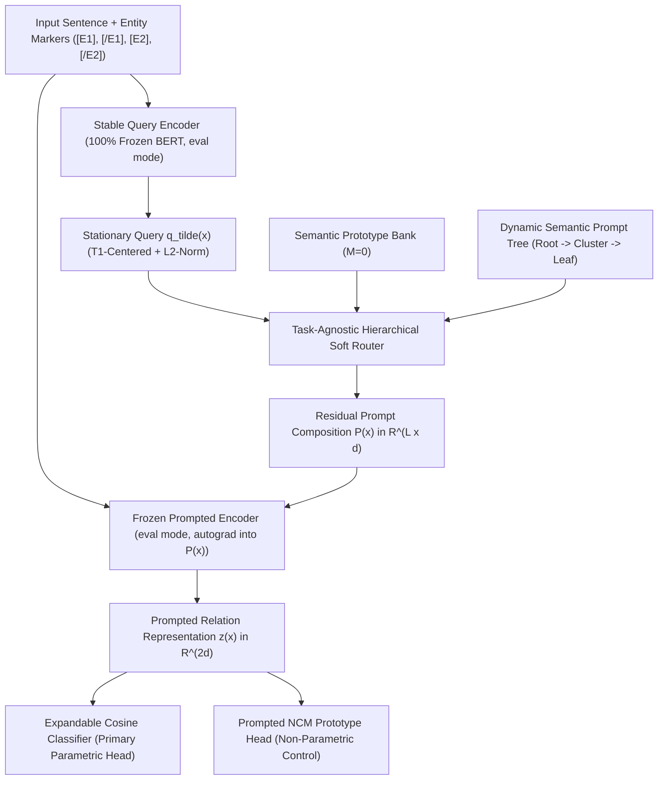

# Đặc Tả Phương Pháp: DynaTree-CRE (MVP Specification)

- **Phiên bản:** `v1.0-MVP`
- **Ngày ban hành:** 2026-11-27
- **Áp dụng cho:** Milestones `M1`–`M6` (`DT-C0` đến `DT-C4`)

---

## 1. Tổng Quan Kiến Trúc

---

## 2. Đặc Tả 10 Module Cốt Lõi

1. **Stable Query Encoder (`src/dynatree_cre/query_encoder.py`):**
   - Backbone mặc định `bert-base-uncased` (hỗ trợ mock/tiny encoder trong unit test).
   - Bổ sung 4 special tokens `["[E1]", "[/E1]", "[E2]", "[/E2]"]`, `resize_token_embeddings` hoàn tất trước khi freeze toàn bộ backbone (`requires_grad=False`).
   - Override `train(mode)` để `self.encoder.eval()` luôn được giữ, triệt tiêu dropout trong cả query extraction lẫn prompted forward.
   - Chiến lược biểu diễn mặc định `"entity_pair"` (`[h_[E1]; h_[E2]]`, `rep_dim = 2 * hidden_size = 1536`), hỗ trợ `"cls"` và `"mean_pool"` động theo `hidden_size`.
   - `encode_query` chạy trong `@torch.no_grad()`; `forward_prompted` **giữ autograd** cho `prompt_embeds` (không bọc `no_grad()` khi train).

2. **Semantic Prototype Bank (`src/dynatree_cre/prototype_bank.py`):**
   - Với mỗi quan hệ $r$ thuộc $D_t$: tính $c_r^{\text{raw}} = \operatorname{Normalize}_2(\frac{1}{N_r}\sum_{i: y_i=r} q(x_i))$.
   - Tại cuối $T_1$, tính và **đóng băng vĩnh viễn** $\mu_{\text{anchor}} = \frac{1}{|\mathcal{R}_1|}\sum_{r \in \mathcal{R}_1} c_r^{\text{raw}}$ (theo RD-005 nhằm triệt tiêu cone anisotropy `cos ~ 0.95` mà không gây trôi prototype cũ).
   - Không gian sử dụng mặc định `"t1_centered_cosine"`: $\tilde{u} = \operatorname{Normalize}_2(u - \mu_{\text{anchor}})$. Hỗ trợ `"raw_cosine"` (diagnostic control) và `"incremental_centered_cosine"`.
   - Tuyệt đối không lưu raw samples hoặc per-instance embeddings qua task boundary.

3. **Incremental Semantic Tree Builder (`src/dynatree_cre/tree.py`):**
   - **MVP Scope:** Độ sâu tối đa `max_depth = 2` (`Root` [depth 0] $\rightarrow$ `Cluster` [depth 1] $\rightarrow$ `Leaf` [depth 2]). Chưa bật split/merge/pruning/reparenting.
   - **T1 Initialization:** Dùng hierarchical agglomerative clustering (`scipy.cluster.hierarchy.linkage` với `method="average"` trên cosine distance $d = 1 - \cos$; cấm dùng `ward` với cosine). Ngưỡng cắt `effective_threshold` lấy từ `tree.insertion_threshold` cố định hoặc `t1_quantile` trên phân bố similarity nội bộ của $T_1$ (không đụng tới test set hay future tasks).
   - **T2..TK Insertion:** Duyệt các relation mới theo thứ tự deterministic (`sorted(relation_id)`). Tính $\cos(c_r, c_j)$ tới toàn bộ cluster hiện có; chọn `best_cluster` (tie-break theo `cluster_id` nhỏ nhất). Nếu `best_score >= effective_threshold`, gắn leaf vào `best_cluster` và cập nhật $c_v = \operatorname{Normalize}_2(\sum_{r \in \text{Leaves}(v)} w_r c_r)$ ($w_r = 1$ mặc định); ngược lại tạo cluster mới.
   - **11 Structural Invariants:** Kiểm tra tự động sau mỗi thao tác (1 root, không cycle, 1 parent/non-root, 1 leaf/seen relation, không future relation, cluster $\ge 1$ leaf, không orphan, node ID ổn định, đúng chiều vector, serialization round-trip nguyên vẹn, không đổi parent relation cũ).

4. **Hierarchical Prompt Bank (`src/dynatree_cre/prompt_bank.py`):**
   - Mỗi node $v$ lưu residual tensor $P_v \in \mathbb{R}^{L \times d}$ với mặc định $L = 8$ (khớp ngân sách token của `P0–P4`, cho phép đổi `L=10` qua YAML).
   - Prompt hiệu dụng cho relation $r$: $P_r^{\text{eff}} = P_{\text{root}} + P_{\text{cluster}(r)} + \Delta P_r \in \mathbb{R}^{L \times d}$.
   - Khởi tạo mặc định `"normal"` (`std=0.02` cho root/cluster, `0.01` cho leaf); hỗ trợ `"embedding_stats"` và `"zero_leaf"`.
   - **Freeze Policy (RD-009):** Tại $T_1$, train `root_prompt`, các cluster mới, các leaf mới. Từ $T_2$ trở đi, đóng băng `root_prompt`, toàn bộ cluster cũ và leaf cũ; **loại bỏ hoàn toàn các tensor đóng băng khỏi parameter group của `AdamW`** để tránh bị `weight_decay` làm trôi.

5. **Task-Agnostic Hierarchical Router (`src/dynatree_cre/router.py`):**
   - Các chiến lược: `"flat_hard"` (`DT-C1`), `"flat_soft_topk"` (`DT-C2`), `"dense_soft"` (control), `"hierarchical_soft"` (`DT-C3`/`DT-C4`, trong đó `DT-C3` học cluster prompt nhưng route phẳng trên leaf để cô lập hierarchical routing vs hierarchical representation), và `"oracle_route"` (tách riêng, không dùng làm standard inference).
   - Chế độ train mặc định: `"inference_consistent"` (không dùng gold label để chọn prompt). Theo dõi tỷ lệ target rơi vào Top-K và bước không có gradient.

6. **Prompt Composition Module:**
   - Với `hierarchical_soft`: $\beta_v = \sum_{r \in \text{TopK}(x): \text{cluster}(r)=v} \alpha_r$, và $P(x) = P_{\text{root}} + \sum_v \beta_v P_v + \sum_{r \in \text{TopK}(x)} \alpha_r \Delta P_r$.
   - Bảo đảm $P_{\text{root}}$ chỉ được cộng **đúng một lần**.

7. **Prompted Relation Encoder:** Forward `P(x)` + input sentence qua `StableQueryEncoder.forward_prompted` để thu $z(x) \in \mathbb{R}^{2d}$.

8. **Global Relation Classifier (`src/dynatree_cre/classifier.py`):**
   - Xuất song song 2 head đánh giá (RD-010):
     1. `ExpandableCosineClassifier`: $l_r(x) = s \cdot \cos(z(x), w_r)$ chỉ trên tập $\mathcal{R}_{\le t}$; trọng số $w_r$ của các quan hệ cũ nằm trong buffer bất biến `old_weights`, chỉ `current_weights` được huấn luyện ở task $t$.
     2. `PromptedNCMClassifier`: so khớp cosine với prototype $p_r$ trích xuất bằng prompt hiệu dụng sau khi train xong task $t$ (để đối sánh trực tiếp với `P0–P4`).

9. **Continual Training Orchestrator (`src/dynatree_cre/trainer.py`):** Thực thi đúng 7 pha (A: Load & Validate $\rightarrow$ B: Prototypes $\rightarrow$ C: Update Tree $\rightarrow$ D: Prepare Model & Freeze $\rightarrow$ E: Train $\rightarrow$ F: Evaluate Seen Tasks $\rightarrow$ G: Consolidate & Release Cache). Kiểm tra `torch.equal` trên snapshot tensor đóng băng sau mỗi task.

10. **Evaluation & Research Logging (`src/dynatree_cre/metrics.py` & `checkpoint.py`):** Lưu `resolved_config.yaml`, `manifest.json`, `metrics.json`, `performance_matrix.csv`, `routing_metrics.json`, `resource_metrics.json`, `trees/task_XX.json`, `checkpoints/after_T{t}/state.pt`.

---

## 3. Ràng Buộc Đào Tạo & Suy Luận

| Ràng buộc | Trạng thái | Ghi chú kiểm chứng |
|---|---|---|
| Raw exemplar replay ($M$) | `0` (Cấm) | Config validator & test bất biến chặn `exemplar_budget != 0` |
| Feature / Generative replay | `false` (Cấm) | Không lưu per-instance query/prompted vectors sau task $t$ |
| Future relation leakage | Cấm | Classifier output dim = $|\mathcal{R}_{\le t}|$; cây chỉ chứa $\mathcal{R}_{\le t}$ |
| Test data leakage | Cấm | Prototypes & threshold chỉ tính trên `train_samples` của task hiện tại |
| Task ID / Gold relation ở inference | Cấm | Chỉ tồn tại ở nhánh `"oracle_route"` tách biệt hoàn toàn |

---

## 4. Hạn Chế Đã Biết Trong MVP (Known Limitations)

1. **Nhạy với thứ tự chèn trong cùng task:** Các quan hệ đến cùng lúc ở $T_t$ được sắp xếp theo `relation_id` cố định; thứ tự chèn khác nhau có thể tạo cụm hơi khác khi ngưỡng sát biên.
2. **Đóng băng cứng cluster prototype vs prompt:** Khi một quan hệ mới gia nhập cluster cũ ở $T_t \ge 2$, cluster prototype $c_v$ được cập nhật theo các leaf thuộc cụm, nhưng cluster prompt $P_v$ bị freeze ở MVP để bảo toàn $P_r^{\text{eff}}$ của các leaf cũ (cần khảo sát controlled plasticity ở `DT-C5` sau MVP).
3. **Zero-grad risk khi Top-K routing ở training:** Nếu một mẫu train mới không có leaf mới nào lọt vào Top-K ở epoch đầu, leaf mới không nhận gradient từ mẫu đó (được theo dõi bằng `train_zero_prompt_grad_steps`).
4. **Độ phức tạp định tuyến MVP:** Duyệt toàn bộ clusters và leaves ($O(C + R)$); chưa tuyên bố $O(\log R)$.
