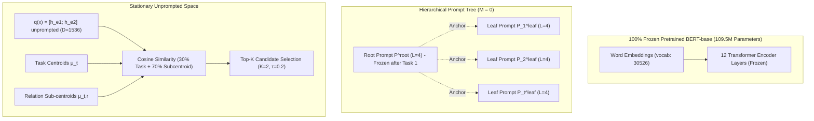

# TAPTA P4 Architecture Audit & Data Flow Map

**Date:** 2026-11-25  
**Auditor:** Senior AI Research Engineer (Antigravity)  
**Method:** TAPTA P4 — Hierarchical Prompt Tree & Decision-Level Soft Prototype Fusion  
**Backbone:** 100% Frozen `bert-base-uncased` (109.5M parameters, requires_grad=False)  

---

## 1. Bản Đồ Trả Lời 12 Câu Hỏi Kiến Trúc Thực Tế (Empirical Answers)

Dựa trên việc đọc và đối soát từng dòng mã nguồn trong `src/models/prompt_bert.py`, `src/models/task_router.py`, và `experiments/run_p4.py`:

| # | Câu hỏi kiểm toán | Câu trả lời xác minh từ Source Code | Dẫn chứng mã nguồn |
|---|---|---|---|
| **1** | **Router nhận embedding từ đâu?** | Router nhận biểu diễn từ hàm `model.extract_unprompted_query()`. Đây là vector nối hai thực thể $[h_{e1}; h_{e2}]$ kích thước 1536 trích xuất trực tiếp từ **100% Frozen BERT KHÔNG có soft prompt** prepended ($q(x)$ unprompted space). Không gian này hoàn toàn stationary (bất biến qua các task). | `prompt_bert.py:202-220` |
| **2** | **Router sử dụng task centroid hay relation sub-centroid?** | Router kết hợp **cả hai**: $30\%$ trọng số từ task centroid và $70\%$ trọng số từ relation sub-centroid cực đại (`subcentroid_weight=0.7`): $S = 0.3 \cdot \cos(q, \mu_t) + 0.7 \cdot \max_r \cos(q, \mu_{t, r})$. | `task_router.py:104-126` |
| **3** | **Router được train hay hoàn toàn phi tham số?** | Trong cấu hình mặc định P4 (`router_type: "centroid"`), Router là **hoàn toàn phi tham số** (Non-parametric Centroid Router). Nó chỉ tích lũy các vector trung bình từ tập huấn luyện support set mà không cần cập nhật gradient. | `task_router.py:44-58, 104-126` |
| **4** | **Root prompt được cập nhật ở những stages nào?** | Root prompt $P^{\text{root}}$ (chiều dài $L_{root}=4$) **chỉ được cập nhật duy nhất tại Stage 0 (Task 1)**. Sau khi hoàn thành Task 1, nó bị đóng băng vĩnh viễn (`requires_grad=False`) để đóng vai trò "invariant semantic anchor". | `run_p4.py:122-141, 188-192` |
| **5** | **Leaf prompt được khởi tạo và freeze như thế nào?** | Khởi tạo độc lập bằng phân phối chuẩn $\mathcal{N}(0, 0.02^2)$. Tại task $t$, chỉ duy nhất leaf prompt $P^{\text{leaf}}_t$ được nạp vào optimizer; các leaf prompt cũ không nhận gradient và được ràng buộc trực giao qua `compute_orthogonality_loss`. | `prompt_bert.py:97-104, 395-421` |
| **6** | **Relation prototypes được tạo ở thời điểm nào?** | Prototypes được tạo **ngay sau khi hoàn thành huấn luyện prompt** của task đó: Mô hình ghép $[P^{\text{root}}; P^{\text{leaf}}_t]$ forward qua 5 mẫu của mỗi quan hệ trong task, tính trung bình vector $[h_{e1}; h_{e2}]$ và lưu vào buffer `prototypes`. | `run_p4.py:193-213` |
| **7** | **Prototypes có được cập nhật khi học task mới không?** | **KHÔNG BAO GIỜ**. Tuân thủ nghiêm ngặt $M=0$ Rehearsal-Free: không lưu mẫu thô của task cũ nên prototype của các task cũ giữ nguyên vĩnh viễn kể từ thời điểm kết thúc task của nó. | `prompt_bert.py:423-431` |
| **8** | **Top-K routing có giới hạn candidate relations không?** | Trong chỉ số chính (`decision_fusion_accuracy`), Top-K routing chọn các prompt ứng viên để tính weighted average của cosine similarities nhưng **cho phép so sánh trên toàn bộ seen relations**. Trong biến thể `topk_gated`, không gian nhãn bị ép giới hạn trong các quan hệ thuộc Top-K tasks. | `run_p4.py:308-338` |
| **9** | **Soft fusion kết hợp logits, probabilities hay embeddings?** | Soft fusion kết hợp **Cosine Similarity Scores** (Decision-Level Similarity Vectors): $S_{fused} = \sum_{k=1}^K w_k \cdot \text{sim}_k$, trong đó $w_k = \text{Softmax}(S_{\text{router}} / \tau)$ với nhiệt độ $\tau=0.2$. | `prompt_bert.py:354-374` |
| **10** | **Các logits giữa những prompt khác nhau có cùng không gian nhãn và cùng cách chuẩn hóa không?** | Tất cả vector biểu diễn và vector prototype đều được chuẩn hóa L2 (`F.normalize`), nên mọi điểm số tương đồng cosine đều nằm trong khoảng $[-1, 1]$. Tuy nhiên, mỗi candidate prompt tạo ra một không gian biểu diễn hơi trôi dạt so với prototype gốc được trích xuất bằng prompt chuẩn của quan hệ đó. | `prompt_bert.py:299-312` |
| **11** | **Task ID được sử dụng ở đâu trong training và inference?** | Training: Dùng Task ID để kích hoạt đúng Leaf Prompt $P_t^{\text{leaf}}$. Inference: **Tuyệt đối KHÔNG dùng Task ID** (Task-Agnostic CIL), router tự động chọn Top-K candidates từ $q(x)$. | `run_p4.py:122, 276-292` |
| **12** | **Checkpoint lưu những trạng thái nào?** | Trong code hiện tại: Chỉ lưu `stage_metadata.json` do lỗi kiểm tra `get_state_dict` thay vì `state_dict`. Checkpoint cần sửa để lưu cả `model.pt` (state_dict của PromptedBERT) và `router.pt` (centroids buffer). | `checkpoint.py:42-49` |

---

## 2. P4 Architecture & Pipeline Diagrams

### 2.1. Kiến Trúc 2 Tầng Cây Mồi Nhắc (Hierarchical Prompt Tree)



---

## 3. Training & Inference Data Flows

### 3.1. Training Data Flow (Task $t$)

```mermaid
sequenceDiagram
    participant D as Support Set (5-shot)
    participant B as Frozen BERT
    participant P as Prompt Tree
    participant O as AdamW Optimizer
    participant M as Prototype Buffer
    participant R as Task Router Buffer

    Note over P,B: Stage t (Learning Task t)
    D->>B: 1. Input tokens with [E1]...[E2]
    P->>B: 2. Prepend [P^root; P_t^leaf]
    B->>O: 3. Compute CE Loss + Orthogonality Loss
    O->>P: 4. Update P_t^leaf (và P^root nếu t=0)
    Note over P: 5. Freeze P^root sau khi xong Task 1
    D->>B: 6. Forward train samples with [P^root; P_t^leaf]
    B->>M: 7. Store Relation Prototypes (Mean Pooling)
    D->>B: 8. Forward train samples WITHOUT prompt
    B->>R: 9. Store Task Centroid & Sub-centroids
```

### 3.2. Inference Data Flow (Task-Agnostic Class-Incremental)

```mermaid
sequenceDiagram
    participant X as Test Sample x
    participant B as Frozen BERT
    participant R as Task Router
    participant P as Prompt Tree
    participant M as Prototype Memory
    participant F as Decision Fusion Head

    Note over X,F: Task-Agnostic Inference (Zero Oracle Task ID)
    X->>B: 1. Forward WITHOUT prompt -> q(x)
    B->>R: 2. Query q(x) to Router
    R->>R: 3. Compute Centroid Sim -> Top-K Tasks & Weights w_k
    loop Cho mỗi Candidate Task k in Top-K (K=2)
        X->>B: 4. Prepend [P^root; P_k^leaf] -> h_r_k
        B->>M: 5. Cosine Sim against ALL seen Prototypes -> sim_k
    end
    M->>F: 6. Send candidate similarity vectors {sim_1, sim_2}
    R->>F: 7. Send confidence weights {w_1, w_2}
    F->>F: 8. Fused Sim = sum(w_k * sim_k)
    F-->>X: 9. Predict Relation = argmax(Fused Sim)
```

---

## 4. Technical Risks & Vulnerability Analysis

1. **Vulnerability 1: Checkpoint Serialization Failure**
   - *Risk:* Toàn bộ trọng số của prompt và buffer prototypes bị mất sau khi script kết thúc; không thể thực hiện các phân tích chẩn đoán hậu kỳ (post-hoc inference diagnostics) nếu không train lại.
   - *Remedy:* Sửa `cl_re_baselines/checkpoint.py` để hỗ trợ cả `model.state_dict()` và lưu trạng thái router.
2. **Vulnerability 2: Representation Discrepancy across Prompts**
   - *Risk:* Prompt của Task 2 biến đổi không gian đặc trưng của mẫu $x$. Khi đối chiếu với prototype của Task 1 (vốn được trích xuất bằng prompt của Task 1), độ tương đồng bị sai lệch.
   - *Remedy:* Nghiên cứu cơ chế Score Normalization (Z-score / Cosine Min-Max) hoặc Gated Candidate Verification.
3. **Vulnerability 3: Hardcoded Baseline References**
   - *Risk:* Khi chạy TACRED, chỉ số `oracle_gap_closed_pct` bị âm do so sánh với mốc tham chiếu của FewRel.
   - *Remedy:* Phân tách rõ ràng bộ thông số tham chiếu theo từng dataset.
