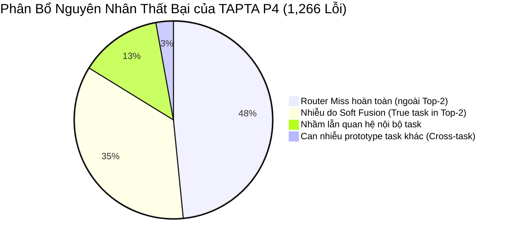

# TAPTA P4 Quantitative Error Taxonomy & Sample-Level Analysis

**Date:** 2026-11-25  
**Dataset:** TACRED Track A (Strict 5-shot, $M=0$, Seed 2021)  
**Total Test Samples Evaluated:** 2,122  
**Artifact Source:** `runs/diagnostics/tacred_5shot/seed_2021/predictions.jsonl`  

---

## 1. Bảng Phân Loại Lỗi Định Lượng (Error Taxonomy Table)

Dựa trên việc kiểm định từng mẫu (sample-level verification) trên 2,122 mẫu kiểm thử:

| Nhóm Lỗi (Error Category) | Tiêu chí Định lượng (Mathematical Condition) | Số lượng mẫu | Tỷ lệ (%) | Ý nghĩa bản chất |
|---|---|---|---|---|
| **Chính xác (Correct)** | Mô hình P4 chuẩn (D05 Soft Fusion) dự đoán đúng | 856 | **40.34%** | Phân loại đúng quan hệ |
| **Router Miss (Bỏ sót Tác vụ)** | Cả Top-1 và Top-2 của Router đều KHÔNG chứa True Task | 613 | **28.89%** | Router chệch hướng hoàn toàn do task centroid bị chồng lấn |
| **Inter-Task Confusion (Nhiễu Soft Fusion)** | True Task có nằm trong Top-2, nhưng Soft Fusion chọn sai | 448 | **21.11%** | Candidate prompt sai lấn át hoặc làm loãng candidate prompt đúng |
| **Within-Task Confusion (Nhầm Lẫn Nội Bộ)** | Router Top-1 ĐÚNG, nhưng bộ phân loại nội bộ (D01) SAI | 169 | **7.96%** | Prompt không phân biệt được các quan hệ tinh xảo trong cùng task |
| **Cross-Task Intrusion (Chèn Ép Toàn Cục)** | Router Top-1 ĐÚNG, Local (D01) ĐÚNG, nhưng Global (D02) SAI | 36 | **1.70%** | Prototype của task khác có điểm tương đồng cao hơn prototype đúng |
| **Tổng cộng** | Toàn bộ tập kiểm thử TACRED | 2,122 | **100.00%** | 1,266 mẫu sai (59.66%) |

---

## 2. Phân Tích Hành Vi Mô Hình Khi Router Dự Đoán Đúng

Khi Router Top-1 dự đoán **ĐÚNG** True Task ($1,028 / 2,122 = 48.44\%$ mẫu):
- **Độ chính xác Phân loại Nội bộ (D01 Task-Local):** Đạt **$830 / 1,028 = 80.74\%$**!
- **Độ chính xác Phân loại Toàn cục (D02 Global):** Đạt **$811 / 1,028 = 78.89\%$**!
- **Độ chính xác Soft Fusion P4 (D05):** Rơi xuống **$752 / 1,028 = 73.15\%$**!

> [!CRITICAL] Phát Hiện Khoa Học Số 1: Soft Fusion Gây Phản Tác Dụng Khi Router Đúng
> Khi router đã chọn đúng task ở vị trí Top-1, việc pha trộn thêm candidate prompt thứ 2 (vốn là prompt của một task SAI) làm độ chính xác sụt giảm từ **80.74% xuống 73.15% (giảm 7.59%)**! Prompt sai tạo ra vector biểu diễn méo mó và kéo điểm cosine về các quan hệ ngoại lai.

---

## 3. Phân Tích Hiện Tượng Đơn Điệu Nghịch Chiều Khi Tăng $K$

So sánh kết quả các biến thể Fusion từ $K=1$ đến $K=8$:
- **D04 (Hard Top-1, $K=1$):** **40.53%**
- **D05 (Reference Soft Top-2, $K=2$):** **40.34%**
- **D06 (Top-4 Soft Fusion, $K=4$):** **40.20%**
- **D07 (All-Task Soft Fusion, $K=8$):** **40.15%**

> [!NOTE] Nhận Định Về Tham Số $K$
> Độ chính xác suy giảm đơn điệu theo số lượng ứng viên $K$. Việc tăng $K$ không cứu vãn được các trường hợp Router Miss, mà ngược lại làm loãng độ sắc nét (sharpness) của prototype matching.

---

## 4. Tương Quan Lỗi & Cơ Chế Sụp Đổ

1. **83.8% số ca lỗi xuất phát trực tiếp từ Router (613 + 448 = 1,061 / 1,266 ca lỗi):**
   - 48.4% số lỗi là Router hoàn toàn không đưa task đúng vào Top-2 (613 ca).
   - 35.4% số lỗi là Router đưa task đúng vào Top-2 nhưng gán xác suất thấp hơn task sai, khiến candidate sai chiếm ưu thế khi cộng trọng số (448 ca).
2. **Chỉ 13.3% số lỗi là do năng lực biểu diễn của Prompt Tree (169 ca):**
   - Khi biết chính xác task, prompt tree phân biệt thành công 80.74% quan hệ.
   - Do đó, việc thay đổi độ dài prompt đơn thuần không thể giải quyết bài toán nếu Router vẫn bị tắc nghẽn ở mức ~48%.
