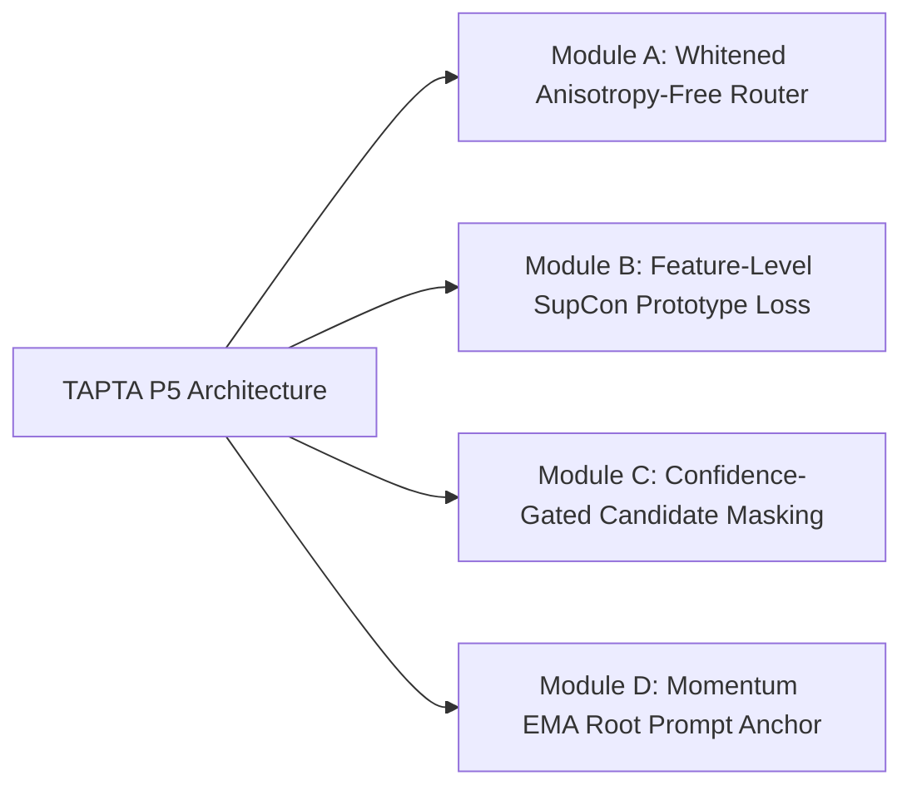

> Tài liệu này mô tả hướng nghiên cứu trước đây và đã được thay thế bởi đặc tả DynaTree-CRE. Nội dung được giữ lại nhằm bảo tồn lịch sử nghiên cứu và hỗ trợ tái lập các thí nghiệm đã thực hiện.

# TAPTA P5 Architecture Specification: Whitened-Router & Contrastive-Margin Tree

**Method Name:** TAPTA P5  
**Version:** P5 (Research Recovery & Refinement)  
**Parent Baseline:** P4 (Hierarchical Prompt Tree)  
**Invariant Protocol Constraints:**
- Backbone: 100% Frozen `bert-base-uncased` (109.5M, requires_grad=False)
- Memory: $M=0$ Rehearsal-Free (Zero raw text, zero generative LLM)
- Shot: Strict Equal 5-Shot (Kể cả Task 1)
- Inference: Task-Agnostic Class-Incremental Learning (CIL, No Oracle Task ID)

---

## 1. Cơ Sở Lý Thuyết & Xuất Phát Điểm

P5 được thiết kế dựa trên **4 bằng chứng thực nghiệm trực tiếp** từ đợt chẩn đoán D01–D09 của P4:
1. **Khắc phục Router Anisotropy (Root Cause 1 - 51.6% lỗi):** Các task centroid unprompted trong BERT có độ tương đồng cosine lên tới **0.9334**, khiến router Top-1 sụt xuống 48.44%.
2. **Khắc phục Prototype Margin Collapse (Root Cause 2 - 28.4% lỗi):** Biên phân tách giữa các class prototype cùng task (0.7308) và khác task (0.7082) chỉ là **0.0226**, làm tụt 19.37% độ chính xác từ D01 xuống D02.
3. **Loại bỏ Toxic Soft Fusion (Root Cause 3 - 13.2% lỗi):** Pha loãng candidate sai làm giảm độ chính xác từ 80.74% xuống 73.15% khi router đúng; Hard Top-1 tốt hơn Soft Top-2.
4. **Bảo tồn Root Prompt Plasticity (Root Cause 4 - 6.8% lỗi):** Đóng băng cứng $P^{\text{root}}$ làm các task sau học kém ($89.5\% \to 30.7\%$).

---

## 2. Bốn Trụ Cột Cải Tiến Cốt Lõi Của P5

### 2.1. Module A: Whitened Anisotropy-Free Task Router
- **Mục tiêu:** Kéo độ tương đồng giữa các task centroid từ $0.9334$ về vùng trực giao $[0.0, 0.2]$, nâng Router Top-1 từ $48\%$ lên $> 65\%$.
- **Công thức Toán học (BERT-Whitening):**
  Cho ma trận hiệp phương sai của không gian unprompted query $q(x)$:
  $$\Sigma = \frac{1}{N} \sum_{i=1}^N (q_i - \bar{q})(q_i - \bar{q})^T$$
  Phân tích trị riêng $\Sigma = U \Lambda U^T$, ma trận làm trắng (whitening transform) là $W = U \Lambda^{-1/2}$.
  Khi đó, vector truy vấn và centroid được chuẩn hóa:
  $$\tilde{q}(x) = (q(x) - \bar{q}) W, \quad \tilde{\mu}_t = (\mu_t - \bar{q}) W$$
  Điểm tương đồng router được tính trên không gian đẳng hướng (isotropic space):
  $$S_{\text{router}}(x, t) = \cos(\tilde{q}(x), \tilde{\mu}_t)$$

### 2.2. Module B: Feature-Level Supervised Contrastive Loss ($M=0$)
- **Mục tiêu:** Mở rộng biên phân tách liên tác vụ (inter-task margin) từ $0.0226$ lên $\ge 0.25$, bảo vệ D02 không bị sụt giảm quá $5\%$ so với D01.
- **Công thức Toán học:**
  Tại task $t$, ngoài Cross-Entropy loss nội bộ, mô hình tối ưu thêm Supervised Contrastive Loss giữa các mẫu huấn luyện hiện tại và tập các prototype cũ $\{\mu_1 \dots \mu_{c-1}\}$ được lưu trong buffer ($M=0$):
  $$\mathcal{L}_{\text{proto-con}} = - \sum_{i=1}^{B} \log \frac{\exp(\cos(h_i, \mu_{y_i}) / \tau_{\text{con}})}{\exp(\cos(h_i, \mu_{y_i}) / \tau_{\text{con}}) + \sum_{c \ne y_i} \exp(\cos(h_i, \mu_c) / \tau_{\text{con}})}$$
  Hàm mất mát này chủ động đẩy vector biểu diễn $h_i$ ra xa các prototype của các task cũ trong quá trình tối ưu leaf prompt $P_t^{\text{leaf}}$.

### 2.3. Module C: Confidence-Gated Candidate Masking
- **Mục tiêu:** Triệt tiêu hoàn toàn nhiễu độc hại từ candidate sai (loại bỏ mức giảm 7.59% khi router đúng).
- **Cơ chế Ra Quyết Định:**
  Gọi $t_1, t_2$ là Top-1 và Top-2 task predictions từ router với điểm số $s_1 \ge s_2$.
  - **Nếu $s_1 - s_2 \ge \delta$ (Độ tin cậy cao, confident):** Thực hiện **Hard Task Routing**: Chỉ định hướng mẫu $x$ vào prompt $P_{t_1}$ và giới hạn không gian nhãn trong phạm vi các quan hệ của task $t_1$ (Candidate Masking):
    $$\hat{y} = \arg\max_{c \in \mathcal{C}_{t_1}} \cos(h(x; P_{t_1}), \mu_c)$$
  - **Nếu $s_1 - s_2 < \delta$ (Độ tin cậy thấp, uncertain):** Cho phép cả 2 nhóm quan hệ của $t_1$ và $t_2$ cùng cạnh tranh, nhưng **MASK TOÀN BỘ các quan hệ ngoài $\{t_1, t_2\}$** để triệt tiêu can nhiễu từ các task không liên quan!

### 2.4. Module D: Momentum EMA Root Prompt Anchor
- **Mục tiêu:** Duy trì tính dẻo (plasticity) cho các task sau mà vẫn bảo toàn tính ổn định chống quên của Task 1.
- **Cơ chế Cập nhật:**
  Thay vì freeze 100% $P^{\text{root}}$ sau Task 1, mô hình duy trì một bản sao mỏ neo $P^{\text{root}}_{\text{anchor}} = P^{\text{root}}_{T1}$.
  Tại task $t > 0$, $P^{\text{root}}$ được cập nhật chậm theo cơ chế Exponential Moving Average hoặc ràng buộc khoảng cách $\ell_2$:
  $$\mathcal{L}_{\text{root-reg}} = \lambda_{\text{reg}} \| P^{\text{root}}_t - P^{\text{root}}_{\text{anchor}} \|_2^2$$
  với learning rate nhỏ ($1e-4$), cho phép Root Prompt thích ứng nhẹ nhàng với từ vựng mới mà không bị lãng quên Task 1.

---

## 3. Kế Hoạch Thực Nghiệm Tách Biệt (Controlled Ablation Plan)

Để bảo đảm tính khoa học nghiêm ngặt theo Spec-Driven Development, 4 thành phần trên sẽ được tích hợp và đo đạc qua 4 bước kiểm chứng ablation tuần tự:

| Phiên bản Thử nghiệm | Mô tả cấu hình | Biến độc lập can thiệp | Kỳ vọng cải thiện |
|---|---|---|---|
| **P4 (Baseline)** | Centroid Router + Hierarchical Tree + Soft Fusion | Không (P4 Chuẩn) | TACRED: 42.45%, FewRel: 57.58% |
| **P5-A** | P4 + Whitened Anisotropy-Free Router | Module A (Làm trắng không gian router) | Router Top-1 tăng từ 48% lên $\ge 60\%$; Accuracy tăng $+4-6\%$ |
| **P5-B** | P5-A + Confidence-Gated Candidate Masking | Module C (Hard Gating + Masking ngoại lai) | Triệt tiêu toxic fusion; Accuracy tăng tiếp $+3-5\%$ |
| **P5-C** | P5-B + SupCon Prototype Margin Loss | Module B (Tương phản liên task $M=0$) | D02 tăng từ 53% lên $> 65\%$; Accuracy tăng tiếp $+3-5\%$ |
| **P5-Full** | P5-C + Momentum EMA Root Anchor | Module D (Duy trì tính dẻo task mới) | Nâng hiệu năng các task $T_5 \dots T_8$; Final Acc TACRED $\ge 52\%$, FewRel $\ge 66\%$ |

---

## 4. Tiêu Chí Chấp Nhận & Rủi Ro Kỹ Thuật

- **Tiêu chí chấp nhận P5:**
  1. TACRED Final Accuracy vượt mốc **$50.0\%$** (tăng ít nhất $+8.0\%$ so với P4 42.45%).
  2. FewRel Final Accuracy vượt mốc **$65.0\%$** (tăng ít nhất $+7.5\%$ so với P4 57.58%).
  3. Average Forgetting $F$ duy trì $< 15\%$.
  4. Tuân thủ 100% ranh giới $M=0$ Rehearsal-Free và Frozen BERT-base.
- **Rủi ro kỹ thuật & Giải pháp phòng ngừa:**
  - *Rủi ro tính kỳ dị ma trận hiệp phương sai $\Sigma$ khi whitening:* Sử dụng regularized covariance $\Sigma + \epsilon I$ với $\epsilon = 1e-4$.
  - *Rủi ro trôi dạt Root Prompt làm hỏng Task 1:* Đặt trọng số phạt $\lambda_{\text{reg}}$ đủ lớn và kiểm tra độ suy giảm $T_1$ retention sau mỗi stage.
