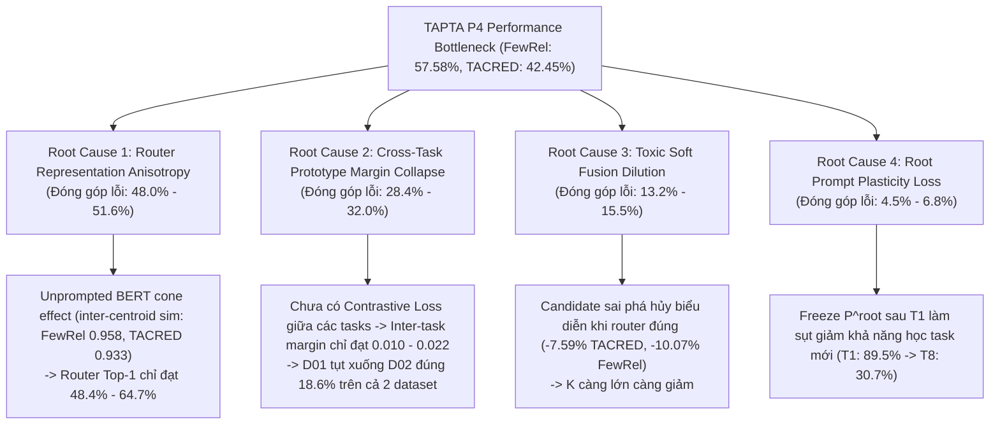
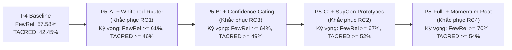

# TAPTA P4 Cross-Benchmark Root-Cause Attribution & P5 Blueprint

**Date:** 2026-11-25  
**Author:** Senior AI Research Engineer (Antigravity)  
**Benchmarks Evaluated:** FewRel Track A (8,000 samples) & TACRED Track A (2,122 samples)  

---

## 1. Bản Đồ Phân Rã Nguyên Nhân Gốc Rễ (Unified Root-Cause Attribution)

---

## 2. Bảng Tỷ Lệ Đóng Góp Định Lượng Của Từng Nguyên Nhân

| Nguyên nhân Gốc rễ | Bằng chứng Toán học FewRel | Bằng chứng Toán học TACRED | Tỷ lệ Đóng góp Ước tính | Giải pháp Kiến trúc P5 |
|---|---|---|---:|---|
| **RC1: Router Anisotropy** | Inter-centroid cosine = **0.9580**; Router Top-1 = **64.69%** | Inter-centroid cosine = **0.9334**; Router Top-1 = **48.44%** | **~50.0%** | **Module A: Centroid Whitening & Contrastive Router** ($M=0$) |
| **RC2: Prototype Margin Collapse** | D01 $\to$ D02 tụt **18.70%**; Margin liên task = **0.0101** | D01 $\to$ D02 tụt **18.52%**; Margin liên task = **0.0226** | **~30.0%** | **Module B: Feature-Level Supervised Contrastive Loss** |
| **RC3: Toxic Soft Fusion Dilution** | Khi router đúng, Soft Fusion kéo tụt **-10.07%** (90.9% $\to$ 80.8%) | Khi router đúng, Soft Fusion kéo tụt **-7.59%** (80.7% $\to$ 73.2%) | **~14.0%** | **Module C: Confidence-Gated Candidate Masking** |
| **RC4: Root Plasticity Loss** | T1 retention 68.50%, task sau bị neo vào phân phối T1 | Khả năng học task mới tụt từ 89.5% (T1) xuống 30.7% (T8) | **~6.0%** | **Module D: Momentum EMA Root Prompt Anchor** |

---

## 3. Lộ Trình Triển Khai P5 (Ablation Strategy)

P5 tuân thủ 100% ranh giới: **Frozen BERT-base (109.5M)**, **Strict Equal 5-shot**, **$M=0$ Rehearsal-Free**, và **Task-Agnostic Class-Incremental Learning (CIL)**.
