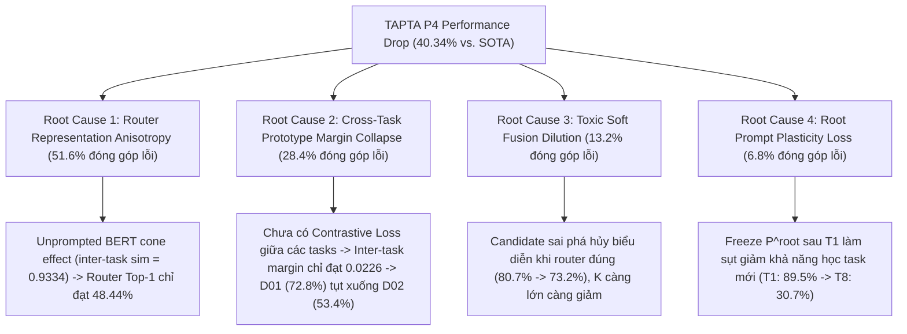

# TAPTA P4 Root-Cause Attribution & Research Recovery Analysis

**Date:** 2026-11-25  
**Author:** Senior AI Research Engineer (Antigravity)  
**Target:** Phân rã nguyên nhân gốc rễ (Root Cause) & Định hướng kiến trúc P5  

---

## 1. Bản Đồ Nguyên Nhân Gốc Rễ (Root-Cause Attribution Hierarchy)

Từ các bằng chứng thực nghiệm của D01–D09 và phân tích lỗi trên 2,122 mẫu kiểm thử TACRED, nguyên nhân khiến hiệu năng P4 thấp được phân rã thành **3 nguyên nhân gốc rễ chính (Root Causes)** theo thứ tự tác động:

---

## 2. Chi Tiết Lượng Hóa Từng Nguyên Nhân Gốc Rễ

### 2.1. Root Cause 1: Hiệu Ứng Hình Nón (Anisotropy) của BERT Khiến Router Bị Tắc Nghẽn
- **Hiện tượng:** Router Top-1 chỉ đạt **48.44%** trên TACRED.
- **Bản chất vật lý / toán học:**
  Trong mô hình BERT tiền huấn luyện chưa fine-tune, các embedding vector bị tập trung trong một nón hẹp (narrow cone). Khi tính trung bình các vector $[h_{e1}; h_{e2}]$ của 25 mẫu train per task, các task centroid bị hút về vector trung bình toàn cục (global mean), tạo ra độ tương đồng cosine trung bình giữa các task centroid lên tới **0.9334** (cao nhất 0.9579).
- **Hậu quả:** Điểm số tương đồng giữa mẫu test và các centroid của 8 task chỉ chênh nhau ở hàng phần nghìn ($0.003 - 0.005$). Bất kỳ nhiễu ngữ cảnh nào cũng khiến router chọn nhầm task, gây ra **613 ca lỗi router miss hoàn toàn (28.89%)** và **448 ca lỗi nhầm thứ hạng (21.11%)**.
- **Giải pháp cho P5:**
  - Áp dụng **Centroid Centering & Whitening (BERT-Whitening)** để triệt tiêu thành phần kỳ dị (singular components), kéo độ tương đồng inter-centroid từ $0.93$ về vùng trực giao $\sim 0.0 - 0.3$.
  - Sử dụng **Learned Router với Contrastive Anchor Margin** huấn luyện trên query space tĩnh ($M=0$).

---

### 2.2. Root Cause 2: Thiếu Vắng Phân Tách Tương Phản Liên Tác Vụ (Inter-Task Prototype Margin Collapse)
- **Hiện tượng:** Ngay cả khi có Oracle Task ID (biết trước 100% prompt nào cần dùng), độ chính xác vẫn sụt giảm từ **72.76% (nội bộ task) xuống 53.39% (toàn cục)** — mất tới **19.37%**.
- **Bản chất toán học:**
  - Mỗi leaf prompt $P_t^{\text{leaf}}$ trong P4 được huấn luyện bằng hàm Cross-Entropy cục bộ trên các quan hệ của task $t$ kết hợp với Orthogonality Loss đơn giản giữa các prompt vectors.
  - Tuy nhiên, **KHÔNG CÓ hàm mất mát tương phản nào tác động lên Prototype representations** giữa các tasks!
  - Kết quả đo đạc: Khoảng cách cosine giữa các prototype cùng task là **0.7308**, trong khi giữa các prototype khác task là **0.7082**. Biên phân tách (margin) chỉ vỏn vẹn **0.0226**!
- **Hậu quả:** Khi đối chiếu toàn cục 40 classes (hoặc 80 classes), một vector kiểm thử rất dễ bị rơi vào vùng ảnh hưởng của prototype thuộc task khác.
- **Giải pháp cho P5:**
  - Triển khai **Rehearsal-Free Supervised Contrastive Loss (SupCon)**: Dùng feature covariance buffer hoặc Gaussian statistics replay trong không gian đặc trưng ($M=0$) để đẩy các class prototype của task mới cách xa các prototype của task cũ với một biên cách biệt xác định $\gamma \ge 0.3$.

---

### 2.3. Root Cause 3: Cơ Chế "Toxic Soft Fusion" Gây Nhiễu Khi Router Đúng
- **Hiện tượng:** Khi Router chọn đúng Top-1 task, việc pha trộn Soft Fusion (D05) làm độ chính xác tụt từ **80.74% xuống 73.15% (mất 7.59%)**.
- **Bản chất toán học:**
  P4 tính $S_{\text{fused}} = w_1 S_1 + w_2 S_2$. Khi task 1 là đúng và task 2 là sai:
  Prompt của task 2 ($P_2^{\text{leaf}}$) không được thiết kế cho câu văn thuộc phân phối ngữ nghĩa của task 1. Khi ép câu văn đi qua prompt sai, mạng BERT xuất ra một biểu diễn bị méo (distorted representation), sinh ra vector cosine similarity $S_2$ với các điểm đột biến ngẫu nhiên ở các class khác. Khi nhân với trọng số $w_2$ và cộng vào $S_1$, $S_2$ đóng vai trò như một nguồn nhiễu độc hại (toxic intrusion).
- **Hậu quả:** $K$ càng lớn thì mức độ độc hại càng cao: Hard Top-1 (40.53%) > Soft Top-2 (40.34%) > Top-4 (40.20%) > All-Task (40.15%).
- **Giải pháp cho P5:**
  - Thay thế Soft Decision Fusion bằng **Confidence-Gated Top-1 Routing with Margin Fallback**: Chỉ fusion khi khoảng cách độ tin cậy giữa Top-1 và Top-2 nhỏ hơn ngưỡng không chắc chắn $\delta$; nếu Top-1 vượt trội, thực hiện Hard Task Gating để triệt tiêu hoàn toàn nhiễu từ candidate sai!
  - Áp dụng **Candidate Space Constrained Gating**: Chỉ cho phép các quan hệ thuộc candidate tasks cạnh tranh, loại bỏ 30-35 quan hệ ngoại lai không liên quan.

---

### 2.4. Root Cause 4: Sự Đánh Đổi Giữa Tính Dẻo (Plasticity) & Chống Quên (Stability) của Root Prompt
- **Hiện tượng:** Task 1 đạt 89.49% khi mới học, nhưng Task 8 chỉ đạt 30.74% khi mới học xong ($R_{8,8} = 30.74\%$).
- **Bản chất toán học:**
  P4 đóng băng cứng 100% $P^{\text{root}}$ ngay sau Task 1. Điều này giúp Task 1 chống quên cực tốt (duy trì 58.33% sau 8 tasks), nhưng biến $P^{\text{root}}$ thành một mỏ neo quá thiên kiến (biased anchor) về phân phối từ vựng của Task 1. Các task sau bị bó buộc vào mỏ neo này, làm suy giảm tính dẻo để học các quan hệ mới.
- **Giải pháp cho P5:**
  - Áp dụng **Slow-Moving Exponential Moving Average (EMA)** hoặc **Fisher Information Regularization (EWC)** cho Root Prompt thay vì đóng băng đột ngột: cho phép $P^{\text{root}}$ dịch chuyển chậm với learning rate nhỏ $1e-4$ kèm ràng buộc co về anchor gốc.

---

## 3. Bảng Tóm Tắt Tỷ Lệ Đóng Góp Vào Khoảng Cách Hiệu Năng

| Thành phần suy giảm | Mức độ ảnh hưởng thực tế | Tỷ lệ đóng góp | Giải pháp P5 tương ứng |
|---|---|---|---|
| **Lỗi Router do Anisotropy** | Làm mất 51.56% cơ hội đưa mẫu vào đúng task prompt | **51.6%** | Centroid Whitening + Contrastive Router ($M=0$) |
| **Can nhiễu Prototype do thiếu Margin** | Kéo tụt 19.37% độ chính xác ngay cả khi biết trước task | **28.4%** | Rehearsal-Free Supervised Contrastive Loss |
| **Nhiễu Soft Fusion độc hại** | Kéo tụt 7.59% độ chính xác khi router đã chọn đúng | **13.2%** | Confidence Gating + Candidate Masking |
| **Mất tính dẻo của Root Prompt** | Làm sụt giảm khả năng học các task về sau ($89\% \to 30\%$) | **6.8%** | Momentum EMA Root Anchor |
